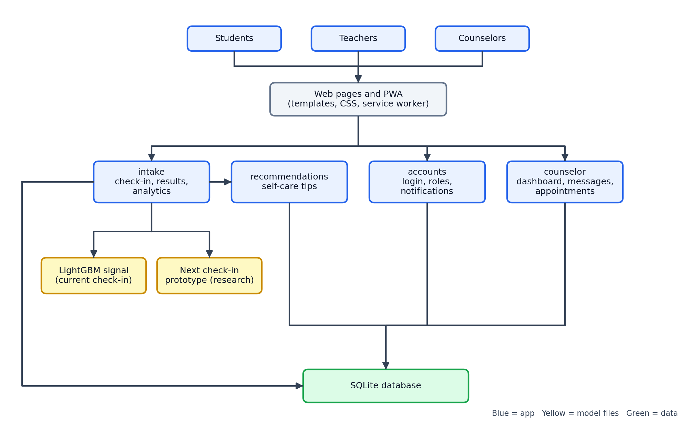
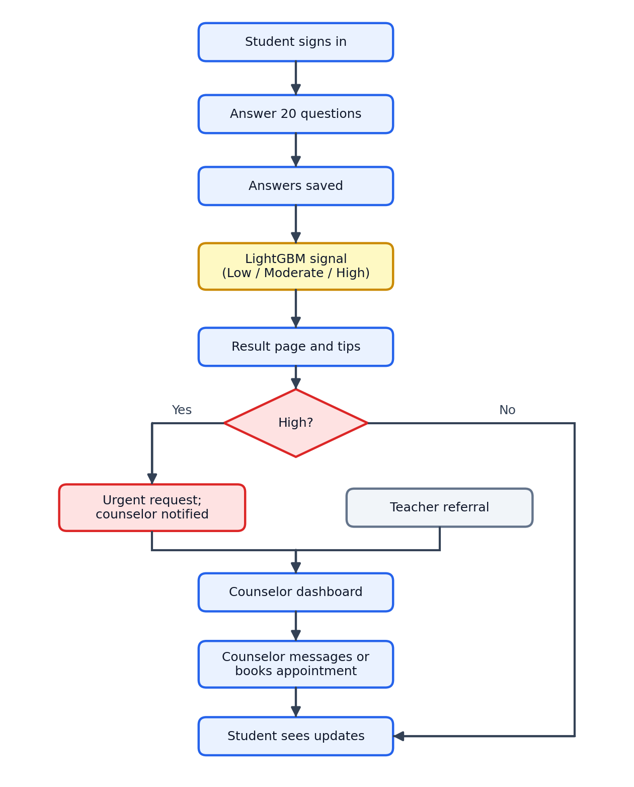
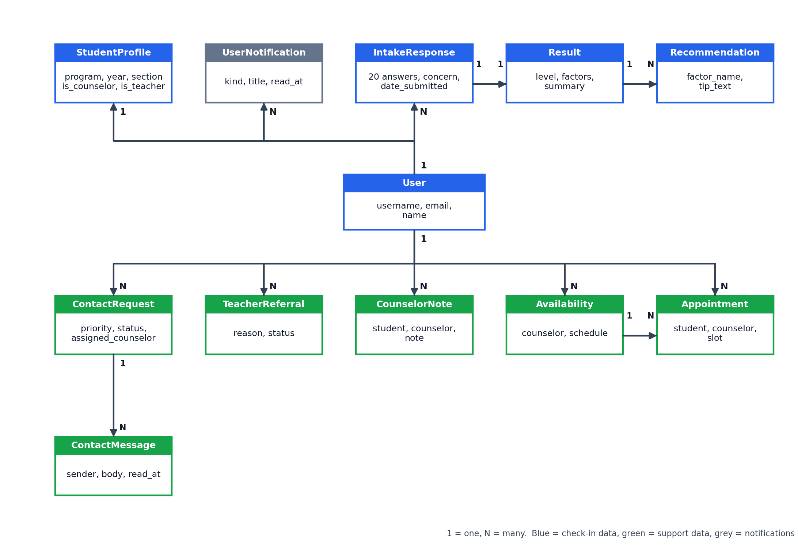
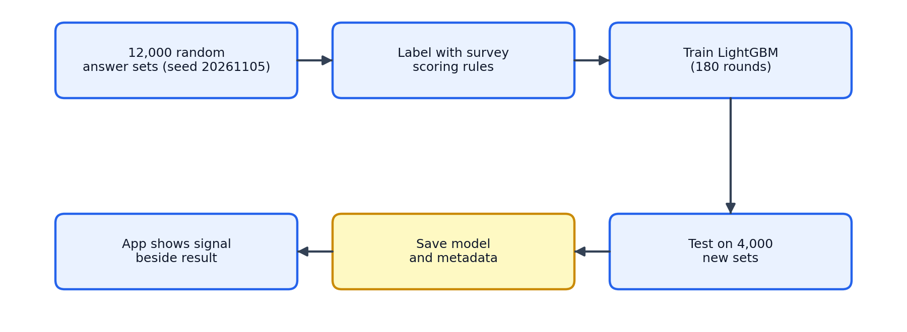

# Chapter 3: Methodology

## 3.1 Introduction

This chapter explains how StudentSense was designed, built, and evaluated. It
describes the research design, the way the system was developed, the people
who use it, how the software is organized, how data moves through it, how the
check-in questionnaire is scored, and how the support-level models were
trained and measured. It also states the ethical safeguards and the limits of
the work.

StudentSense is a web application that students, teachers, and school
counselors open in a phone or computer browser. Students complete a short
weekly check-in. The system turns the answers into a support level (Low,
Moderate, or High), gives self-care tips, and alerts a counselor when a
check-in needs prompt attention.

> **Note for the researchers.** Items in this chapter that describe the study
> process (research design label, development approach, and evaluation data)
> follow what is actually present in the project's code and history. If your
> institution requires a particular design label, participant count, or ethics
> approval number, add it in Sections 3.2 and 3.12. No such details were
> available in the project files, so none have been invented here.

## 3.2 Research design

The study uses a **developmental (design-and-build) research design with a
quantitative evaluation**. The work has two parts:

1. **Building the system.** A working application was designed, programmed,
   and tested against a list of required features.
2. **Evaluating the support-level model.** The model was trained and then
   measured with standard classification measures (Section 3.10).

The model evaluation and the demonstration records used in this study are
**generated (synthetic) data**. They are used to show that the software and the
training process work from start to finish. They are not responses collected
from real students, and they are not evidence about any real person's wellbeing.

## 3.3 Development approach

The system was built in small, repeated cycles (iterative prototyping). Each
cycle added or refined a feature, tested it, and corrected problems before the
next one began. The main cycles were:

| Cycle | Main result |
|---|---|
| 1 | Accounts and roles (student, teacher, counselor) |
| 2 | The 20-question check-in, survey scoring, and result page |
| 3 | Recommendations, history, and personal analytics |
| 4 | Counselor support dashboard, messaging, teacher referrals, notes, and appointments |
| 5 | First support-level model and a research prototype for the next check-in |
| 6 | Mobile-first design, notifications, and installable web app behavior |
| 7 | Visual refinement, clearer answer labels, and testing |

## 3.4 System requirements

### 3.4.1 Users and their roles

| Role | What the person can do |
|---|---|
| **Student** | Create an account, complete check-ins, view results, history and personal analytics, message the counselor, ask for urgent help, and book appointments |
| **Teacher** | Refer a student to the counselor. Teacher accounts stay disabled until a counselor approves them |
| **Counselor** | Review urgent requests, teacher referrals, and students who need attention. View each student's analytics, send messages, add private notes, set availability, and manage appointments |

### 3.4.2 Main features

- Account sign-up and sign-in, with role-based access
- A 20-question check-in with a 1-to-5 answer scale, plus a few daily-habit questions
- Automatic draft saving, so a student can return to an unfinished check-in
- A result page with the support level, scores for four areas, and tips
- Check-in history and personal analytics
- An experimental "possible next support level" view (research only)
- Counselor dashboard, student list, and analytics for each student
- Two-way messaging, urgent-help requests, and teacher referrals
- Appointment availability and booking
- In-app notifications, and browser push notifications when configured
- Use on small phone screens and installation as a home-screen app

### 3.4.3 Quality requirements

- **Privacy:** only the student and counselors can see a student's results.
- **Safety:** a High result opens an urgent follow-up. The system never claims to diagnose.
- **Usability:** short screens, clear labels, and a layout that works on phones.
- **Reliability:** automated tests cover the main flows, so changes can be checked quickly.

## 3.5 System architecture

StudentSense is a **Django** (Python) application. Django is split into
"apps", and each StudentSense app has one clear job.

**Figure 1 explanation.** Students, teachers, and counselors all use the system
through a web browser. The page templates and style sheet display the screens,
and a small background script (a service worker) lets the app work like an
installed phone app. Behind the screens, four application areas do the work:

| App area | Purpose |
|---|---|
| `accounts` | Sign-up, sign-in, user roles, and notifications |
| `intake` | The check-in, scoring, results, history, and analytics |
| `recommendations` | The self-care tips attached to each result |
| `counselor` | The support dashboard, messages, referrals, notes, and appointments |

The `intake` area reads two saved model files (Section 3.9). All areas store
their information in one **SQLite** database file.

## 3.6 System flow

**Figure 2 explanation.** The flow starts when a student signs in and finishes
the 20-question check-in. The answers are saved and passed to the LightGBM model, which gives the Low, Moderate, or High support signal. The result
page shows the level, the area scores, and tips. If the level is **High**, the
system automatically opens an urgent help request and notifies the student and
the counselor. Teacher referrals reach the same counselor dashboard. The
counselor can then review analytics, send a message, or book an appointment,
and the student sees these updates in their own pages.

## 3.7 Database design

The database stores each fact once and links records together, as shown below.

**Figure 3 explanation.** Everything is linked to the user account. In blue:
a user has one profile, and can have many check-ins (`IntakeResponse`). Each
check-in has exactly one `Result`, and a result can have several
`Recommendation` tips. In green, the counselor tables record support requests
and their messages, teacher referrals, counselor notes, availability, and
appointment bookings. In grey, `UserNotification` stores messages shown in the
notification page. Results can be archived instead of deleted, so history is
not lost by accident.

## 3.8 Data collection instrument and scoring

### 3.8.1 The check-in

Each check-in has **20 questions**, each answered on a five-point scale:
**1 – Never, 2 – Rarely, 3 – Sometimes, 4 – Often, 5 – Very often.** The
questions are grouped into four areas that are adapted from published student
wellbeing scales.

| Area | Questions | Number of items | Possible score |
|---|---|---|---|
| Academic burnout | 1–5 | 5 | 5–25 |
| Academic stress and workload | 6–10 | 5 | 5–25 |
| Social media usage | 11–16 | 6 | 6–30 |
| Sleep patterns and habits | 17–20 | 4 | 4–20 |

The check-in also asks about everyday habits (study hours, sleep hours, social
media hours, deadline pressure, class load, mood and energy, exercise, and
sleep consistency) and offers an optional note and an optional supporting file.
The file must be a PDF, DOC, DOCX, TXT, JPG, or PNG of 50 MB or less.

### 3.8.2 How the support level is decided

The scoring rules are simple and visible, so counselors can understand them.

1. **Score each area.** Add up the answers in the area.
2. **Give each area a band.** The possible score range is split into three equal
   parts: the lowest third is **Low**, the middle third is **Moderate**, and the
   highest third is **High**.

   | Area | Low | Moderate | High |
   |---|---|---|---|
   | Academic burnout | 5 to 11.7 | above 11.7 to 18.3 | above 18.3 |
   | Academic stress and workload | 5 to 11.7 | above 11.7 to 18.3 | above 18.3 |
   | Social media usage | 6 to 14 | above 14 to 22 | above 22 |
   | Sleep patterns and habits | 4 to 9.3 | above 9.3 to 14.7 | above 14.7 |

3. **Combine the four bands into the overall level.**
   - **High** if two or more areas are High, or if burnout is High and stress
     and workload is Moderate or High.
   - **Moderate** if one area is High, or two or more areas are Moderate.
   - **Low** otherwise.

These bands are **provisional survey bands, not clinical cut-offs**. They show
where a student may want support. They do not diagnose anything.

## 3.9 Support-level models

StudentSense has two separate models. Neither one replaces the scoring rules
in Section 3.8.2.

### 3.9.1 Model in the app: the current-check-in support signal

| Item | Description |
|---|---|
| Purpose | Show a second, experimental support signal beside the survey result |
| Method | LightGBM, a tree-based machine-learning method, used for three-way classification |
| Input | The 20 answers from the current check-in |
| Output | Low, Moderate, or High, with probabilities |
| Training data | 12,000 generated sets of 20 random answers (1 to 5), made with a fixed random seed so that the run can be repeated |
| Labels | Each generated set was labeled using the scoring rules in Section 3.8.2 |
| Settings | 180 boosting rounds, learning rate 0.05, 31 leaves per tree, at least 20 records per leaf, 90% of features and 90% of records sampled each round |
| Saved as | A model file and a metadata file inside the `intake` folder |

**Figure 4 explanation.** The pipeline generates answers, labels them with the
scoring rules, trains the model, tests it on 4,000 new generated sets, saves it,
and lets the app load it. Because the labels come from the scoring rules, the
model learns to **copy those rules**. It was not trained on real students or
on a validated mental-health outcome. For that reason it is described as
experimental, and it never changes the official result.

### 3.9.2 Research prototype: possible next support level

| Item | Description |
|---|---|
| Purpose | Explore whether earlier check-ins can hint at the level of the next check-in |
| Method | Multinomial logistic regression (scikit-learn) with standardized inputs and balanced class weights |
| Input | The most recent check-in (scores, habits, and its level) plus how many check-ins the student has made and the days since the previous one |
| Training rows | One row for every pair of back-to-back check-ins by the same student |
| Splitting | By **student**, so the same student is never in both training and testing |
| Safeguards | At least 30 pairs are required, and Low, Moderate, and High must appear in both the training and testing groups |
| Use in the app | Shown on the analytics page after two check-ins, labeled experimental, and it never triggers alerts |

The prototype needs a saved model file. The file is created by running the
training script and is not stored in the code repository.

## 3.10 Evaluation procedure

The models are measured on **test data that the model has not seen during
training**. The following measures are used.

| Measure | Plain-English meaning |
|---|---|
| **Accuracy** | The share of all test records that were labeled correctly |
| **Balanced accuracy** | The average correct share per level, so a rare level counts as much as a common one |
| **Precision** | When the model says a level, how often it is right |
| **Recall** | Of the records that truly belong to a level, how many the model finds |
| **Macro F1** | One combined score of precision and recall, averaged equally across Low, Moderate, and High |
| **Confusion matrix** | A table of true levels against predicted levels that shows the kinds of mistakes |

Recall for the **High** level is the most important in practice, because a
missed High result is the costliest mistake. Results are reported in Chapter 4.

## 3.11 Software testing and tools

### 3.11.1 Testing

| Test type | What it checks |
|---|---|
| Automated tests for public pages | The home, about, and sign-in pages load |
| Form and model tests | Check-in answers, labels, and database rules |
| Account tests | Sign-up, sign-in, roles, and teacher approval |
| Check-in tests | Scoring, results, history, analytics, and drafts |
| Counselor tests | Dashboard, messages, referrals, notes, and appointments |
| Browser tests | Page layout and behavior on a phone-sized screen |
| Performance checks | Pages stay fast with many records |
| Manual testing | A person tries the main pages in a real browser |

### 3.11.2 Tools and environment

| Tool | Use |
|---|---|
| Python and Django 5.2 | Application framework |
| SQLite | Database |
| LightGBM 4.7 | Model used inside the app |
| scikit-learn 1.9 and joblib | Next-check-in research prototype |
| pywebpush | Browser push notifications |
| HTML, CSS, JavaScript, and a service worker | Screens and installable behavior |
| PythonAnywhere | Online hosting |
| Git and GitHub | Version control |

## 3.12 Ethical considerations and data protection

- **Not a diagnosis.** Every results page and analytics page states that the
  output is not a medical diagnosis. Counselor judgment always comes first.
- **Careful handling of High results.** A High result opens an urgent help
  request, so a counselor can follow up quickly, but the wording avoids alarming
  the student.
- **Role-based access.** Counselor pages reject anyone who is not a counselor.
  Students can only open their own results and files.
- **Teacher approval.** A new teacher account cannot sign in until a counselor
  approves it.
- **Safe file uploads.** Only listed file types up to 50 MB are accepted, and
  the file type must match its extension.
- **Synthetic data.** The demonstration accounts and records are generated, are
  clearly labeled as demonstration data, and use fake e-mail addresses. They
  must not be presented as real participants.
- **Before real use.** Using StudentSense with real students requires the
  school's and the institution's ethics approval, informed consent (and parent or
  guardian consent where students are minors), a data-privacy review, and
  counselor-reviewed validation of the questions and scoring.

## 3.13 Limitations of the method

- The scoring bands are provisional and have not been validated against a
  clinical measure.
- The in-app model was trained on generated answers labeled by the scoring
  rules, so its accuracy shows how well it copies those rules, not how well it
  recognizes real distress.
- The next-check-in prototype depends on how many students and check-ins are
  available, and its results should be read as exploratory.
- Demonstration data cannot show real usage, real changes in students, or real
  counselor workload.
- The answers are self-reported and can be affected by mood, honesty, and
  understanding of the questions.
