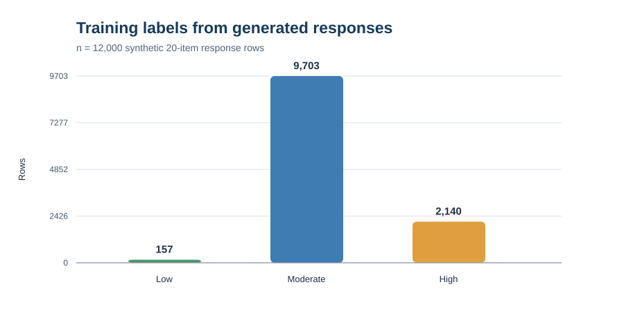
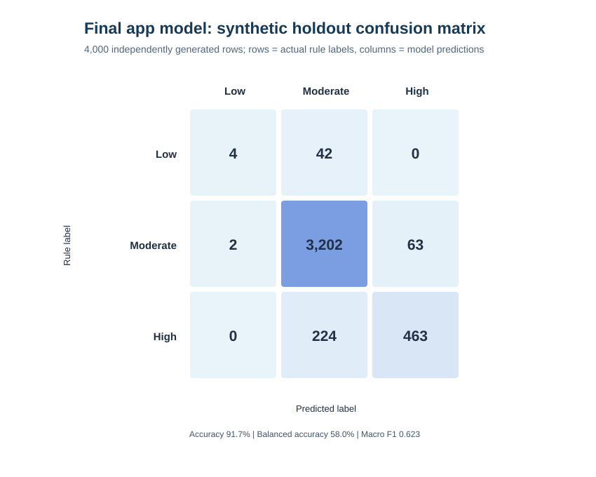
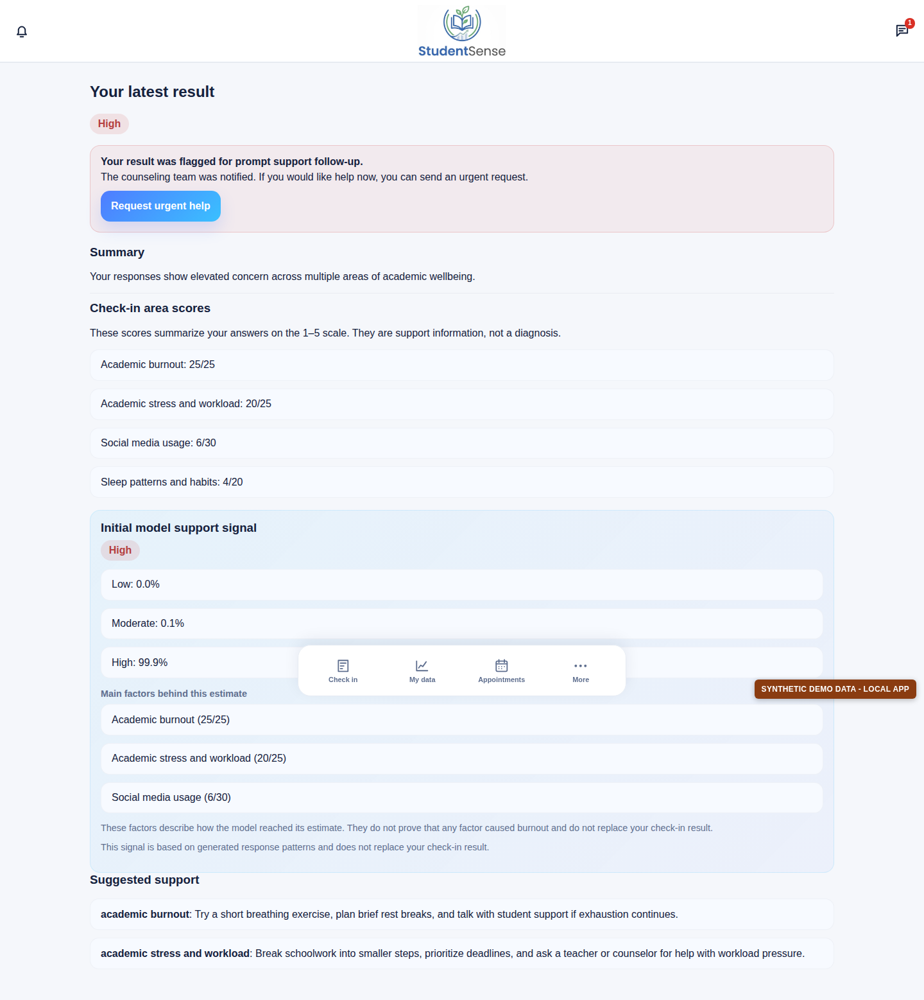
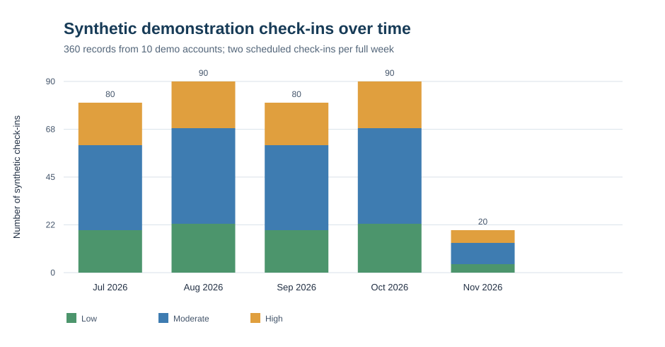
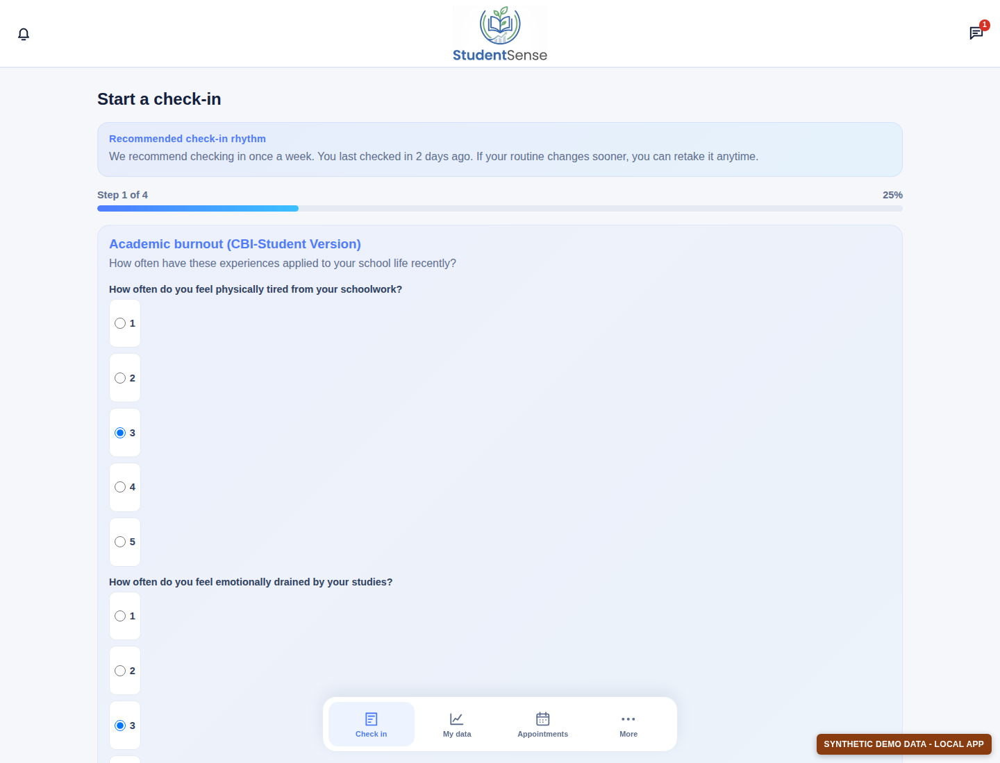
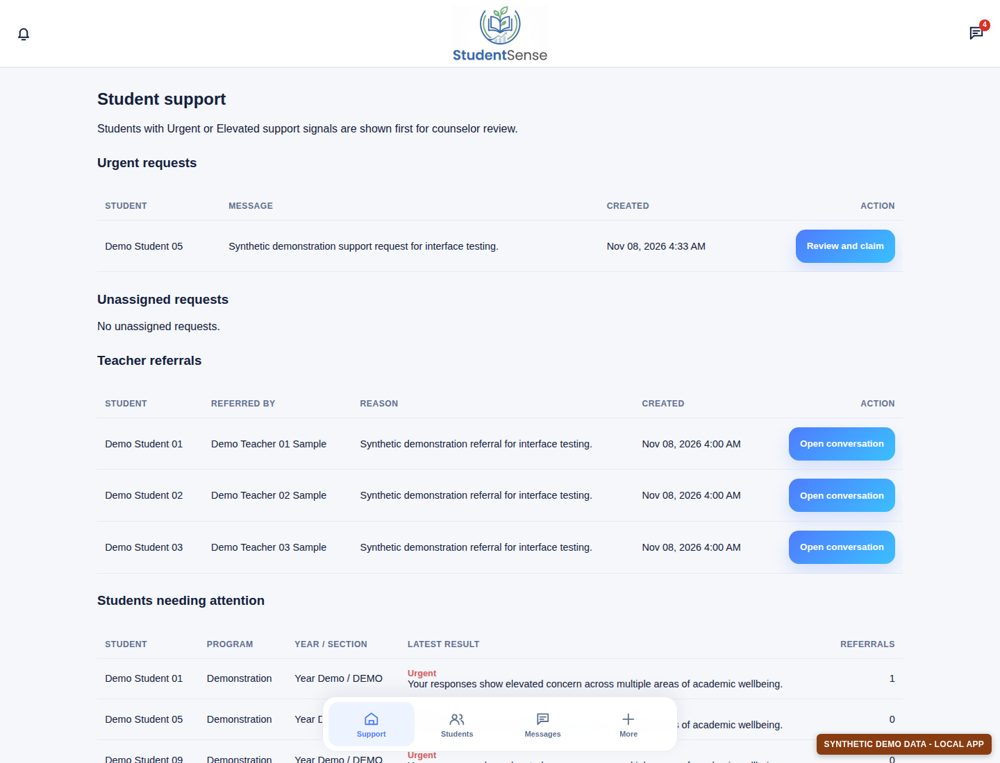
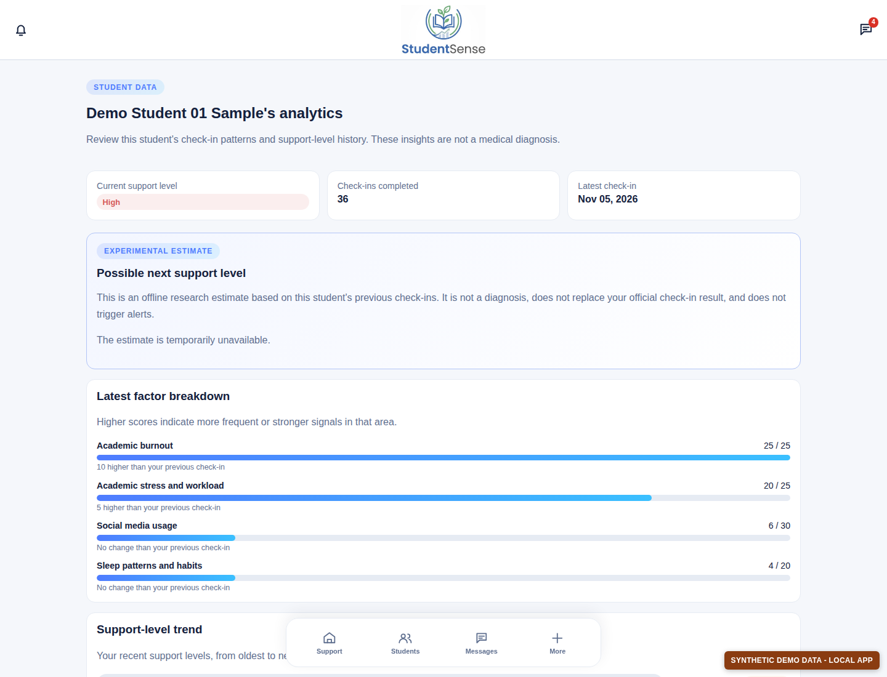
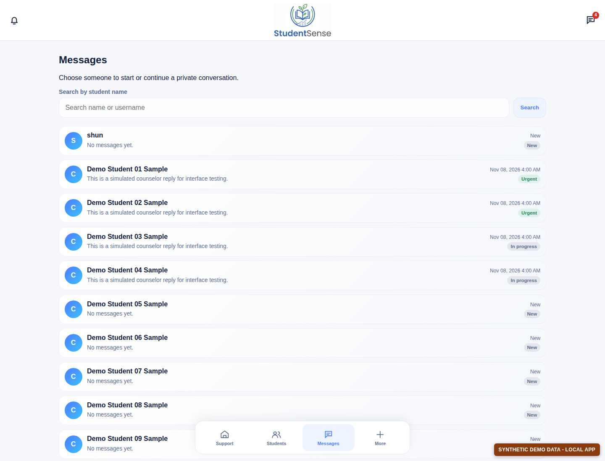
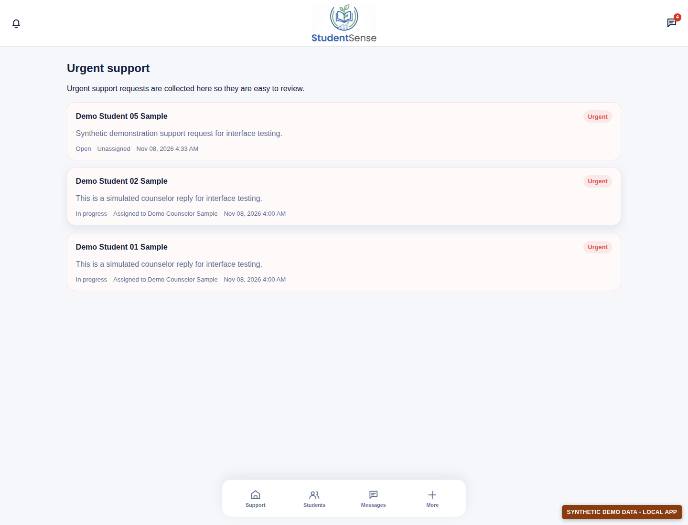
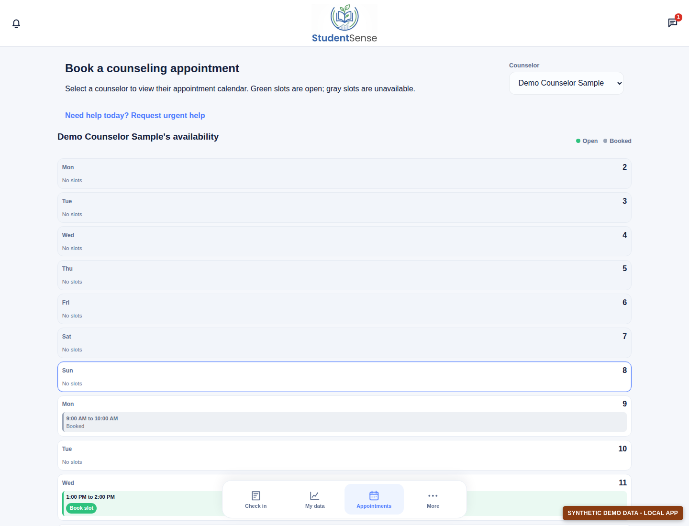

# Chapter 4: Results and Discussion

## 4.1 Introduction

This chapter presents two different kinds of results: an evaluation of the
StudentSense support-level model and a demonstration of the application's main
pages. The model evaluation uses generated questionnaire responses. The local
application screenshots use generated demonstration accounts and records.

**These are synthetic results, not findings from real students or teachers.**
The generated records do not show that an actual four-month study took place.
They must not be reported as real participant data or as evidence that the
model can identify a student's mental-health needs. The model is not a
diagnostic tool.

## 4.2 Model training results

### Training data and method

The model used by the check-in result page is a LightGBM classifier. The
training script generated 12,000 rows, with 20 questionnaire answers in each
row. Each answer was an integer from 1 to 5. The script assigned the labels
**Low**, **Moderate**, or **High** using the application's survey scoring rules.
The model therefore learned to approximate those rules; it was not trained on
responses collected from people.

The saved application model was trained using 180 boosting rounds. To measure
how it performed on new generated examples, it was evaluated on a separate set
of 4,000 generated rows. This test set used a different random seed, but the
same response generator and labeling rules. The test is useful for checking
the model implementation, but it is not an independent clinical or real-world
validation.

The training set contained 157 Low labels (1.3%), 9,703 Moderate labels
(80.9%), and 2,140 High labels (17.8%).



**Figure 1 discussion.** Most generated rows were labeled Moderate, while very
few were labeled Low. This imbalance matters when interpreting the model's
accuracy: a model can perform well on the largest group while missing much of
a smaller group. The distribution is a result of the response generator and
the scoring rules, not a measured distribution of student wellbeing.

### Final application model evaluation

Table 1 summarizes the saved application model's results on the 4,000-row
synthetic test set.

| Measure | Result |
| --- | ---: |
| Overall accuracy | 91.7% |
| Balanced accuracy | 58.0% |
| Macro F1 score | 0.623 |
| Test rows | 4,000 |

The confusion matrix below shows the actual rule-based label in each row and
the model's predicted label in each column.



**Figure 2 discussion.** The model correctly classified 3,202 of 3,267
Moderate rows and 463 of 687 High rows. It correctly classified only 4 of 46
Low rows; the other 42 were predicted as Moderate. This explains why the
overall accuracy is 91.7% while balanced accuracy is much lower at 58.0%.
Accuracy alone would hide the weak result for the Low group. The model's
performance on these generated examples should not be treated as evidence of
performance with real students.

### How the model appears in the application

The saved model reads the 20 check-in answers and returns a predicted support
label, class probabilities, and the highest questionnaire-area scores. The
result page also shows the application's survey-rule result. These are
separate outputs: the survey rules produce the displayed check-in result, and
the LightGBM model provides an additional support signal. The area scores are
questionnaire totals; they do not prove that an area caused a result.

Although the response generator creates many randomized examples for testing,
it does not represent a student's real check-in history. The deployed
LightGBM model uses the 20 answers from the current check-in; it does not learn
from a student's earlier submissions. Repeated check-ins can help the app
display changes in a student's history, but they do not by themselves improve
the model's accuracy or prove that it recognizes that student's patterns
better. Demonstrating such improvement would require a separately designed
longitudinal model, appropriate real-world data, and evaluation on students
who were not included in training.



**Figure 3 discussion.** The result page presents the check-in result, area
scores, model probabilities, and suggested support information. The page also
states that the model signal is based on generated response patterns and is
not a diagnosis. The displayed probability is an output from this model for
this synthetic example; it is not a measure of a real student's risk.

The separate scripts in `model_prototype/` are exploratory research
prototypes. They are not the saved model evaluated above and are not used to
produce the application's check-in result.

## 4.3 Local application demonstration

### Demonstration data

For screenshots and page testing, the repository's local SQLite database was
populated with:

- 10 synthetic student accounts;
- 3 synthetic, approved teacher accounts;
- 1 synthetic counselor account;
- 360 generated check-ins, dated July 6 to November 5, 2026;
- 36 check-ins per student, scheduled twice per week across 18 weeks; and
- sample messages, support requests, teacher referrals, and appointment
  availability.

The dates and answers were generated for this demonstration. They do not
represent real attendance, conversations, referrals, appointments, or student
responses. The records remain in the local database so the pages can be
reviewed again. The safe, repeatable command is:

```bash
.venv/bin/python manage.py seed_chapter4_demo_data
```

The command is restricted to the repository's local SQLite database with
development mode enabled. It adds missing demonstration records and does not
delete existing records.



**Figure 4 discussion.** The chart shows how the generated records are spread
over the demonstration period. The partial months contain fewer check-ins
because the schedule starts and ends partway through those months. The Low,
Moderate, and High counts were deliberately created for page testing. They are
not observed changes in student wellbeing and should not be used as study
findings.

### Main application pages



**Figure 5 discussion.** The check-in page groups questionnaire items into
steps and uses a 1-to-5 response scale. The page displays a suggested weekly
check-in rhythm. This screenshot shows the form interface; no check-in was
submitted as part of taking the screenshot.



**Figure 6 discussion.** The counselor dashboard brings together support
requests, teacher referrals, and students whose latest results need attention.
The rows and messages shown here were generated for the local demonstration.
They illustrate how a counselor can review information in one place; they do
not represent real cases or actual follow-up.



**Figure 7 discussion.** The analytics page summarizes a student's check-in
count, latest result, area scores, and recent support-level history. The
screenshot shows 36 generated check-ins. Its separate next-check-in estimate
is an offline experimental feature and may be unavailable when its optional
research artifact has not been trained. It is not the final application model
described in Section 4.2.



**Figure 8 discussion.** The message list groups conversations by student and
shows each thread's latest message and status. The sample conversations were
created solely to make the local interface usable for screenshots. No real
student or counselor communication is shown.



**Figure 9 discussion.** The urgent-support page collects requests for
counselor review and indicates whether each request is assigned. The names
and messages in this screenshot belong to synthetic accounts and are not real
support cases.



**Figure 10 discussion.** The appointment page lets a student review a
counselor's available times and shows booked times as unavailable. The open
and booked slots in this screenshot were created for interface testing; they
do not document actual appointments.

## 4.4 Summary and limitations

The saved application model can reproduce some of the rule-based labels on
generated questionnaire rows, but its results are uneven across classes. In
particular, its recall for the Low class was 8.7% on the synthetic test set.
The strong overall accuracy is influenced by the large number of Moderate
examples. These results are a software-development check, not a validated
assessment of students.

The local database and screenshots demonstrate the application's check-in,
analytics, counselor support, messaging, and appointment workflows. All
accounts, records, messages, referrals, and appointments created for these
screenshots are synthetic. A study with real participants would require
appropriate approvals, consent and privacy protections, a defined evaluation
method, and independent review of the model before its results could support
research claims or student-support decisions.
